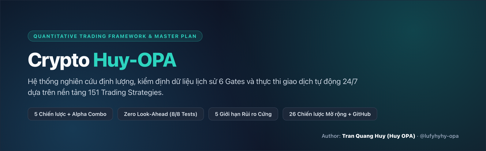
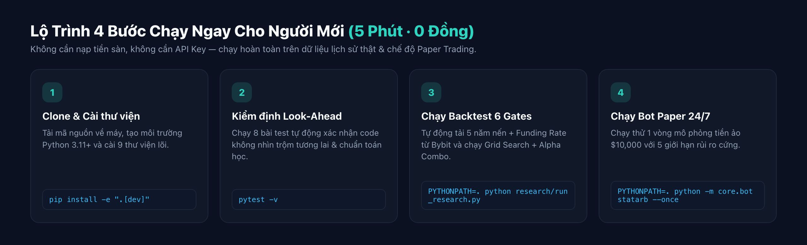
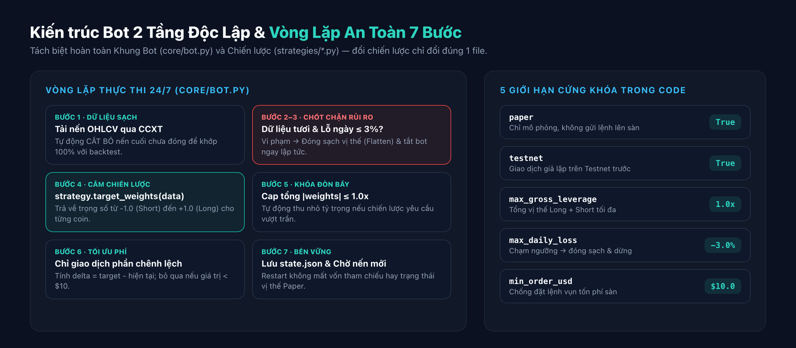
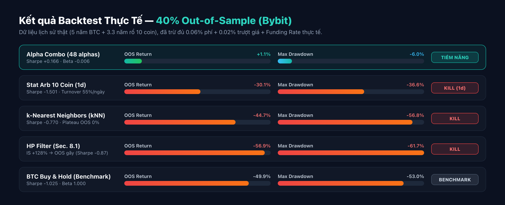

<p align="center">
  
</p>

<p align="center">
  
  
  
  
  
</p>

<p align="center">
  <strong>Crypto Huy-OPA — Hệ thống Giao dịch Định lượng &amp; Tài liệu Master Plan Chuyên sâu</strong><br/>
  Khung nghiên cứu, kiểm định dữ liệu lịch sử (Backtesting) và thực thi giao dịch tự động 24/7 xây dựng theo chuẩn mực định lượng từ công trình <em>151 Trading Strategies</em> (Kakushadze &amp; Serur).
</p>

---

## Mục Lục
1. [Tài Liệu Master Plan Toàn Diện (3 Định Dạng)](#1-tài-liệu-master-plan-toàn-diện-3-định-dạng)
2. [Hướng Dẫn Cài Đặt & Khởi Chạy Nhanh (5 Phút · Không Cần Vốn)](#2-hướng-dẫn-cài-đặt--khởi-chạy-nhanh-5-phút--không-cần-vốn)
3. [Kiến Trúc Hệ Thống 2 Tầng & 5 Giới Hạn Quản Trị Rủi Ro](#3-kiến-trúc-hệ-thống-2-tầng--5-giới-hạn-quản-trị-rủi-ro)
4. [Kết Quả Kiểm Định Thực Nghiệm (Dữ Liệu Bybit · 40% Out-of-Sample)](#4-kết-quả-kiểm-định-thực-nghiệm-dữ-liệu-bybit--40-out-of-sample)
5. [Cấu Trúc Mã Nguồn & Tích Hợp Chiến Lược Mới](#5-cấu-trúc-mã-nguồn--tích-hợp-chiến-lược-mới)
6. [Xử Lý Các Lỗi Thường Gặp (FAQ)](#6-xử-lý-các-lỗi-thường-gặp-faq)

---

## 1. Tài Liệu Master Plan Toàn Diện (3 Định Dạng)

Tài liệu trình bày chi tiết từng bước triển khai: kiến trúc phần mềm, mã nguồn đầy đủ, quy trình kiểm định 6 cổng (6 Gates), mẫu câu lệnh đánh giá rủi ro và danh mục **26 chiến lược mở rộng kèm kho mã nguồn GitHub tham khảo**:

| Định dạng | Mục đích sử dụng | Truy cập |
|---|---|---|
| **PDF chuẩn A4** | Đọc trực tiếp trên máy tính, điện thoại hoặc in ấn | [`MASTER_PLAN_151_STRATEGIES_CRYPTO_BOT.pdf`](./MASTER_PLAN_151_STRATEGIES_CRYPTO_BOT.pdf) |
| **Web-Book HTML** | Đọc trên trình duyệt có mục lục điều hướng & nút sao chép mã nhanh | [`MASTER_PLAN_151_STRATEGIES_CRYPTO_BOT.html`](./MASTER_PLAN_151_STRATEGIES_CRYPTO_BOT.html) |
| **Markdown (.md)** | Xem trực tiếp trên GitHub hoặc tích hợp vào Notion | [`MASTER_PLAN_151_STRATEGIES_CRYPTO_BOT.md`](./MASTER_PLAN_151_STRATEGIES_CRYPTO_BOT.md) |
| **Google Drive trọn gói** | Tải toàn bộ tài liệu và gói mã nguồn nén (.zip) | [Mở thư mục Google Drive](https://drive.google.com/drive/folders/1vIGo7TBLtIsVUu8rGJjbCiCiSEs1May2) |

---

## 2. Hướng Dẫn Cài Đặt & Khởi Chạy Nhanh (5 Phút · Không Cần Vốn)

<p align="center">
  
</p>

> Hệ thống hỗ trợ tải dữ liệu lịch sử công khai và mô phỏng Paper Trading hoàn toàn miễn phí — **không yêu cầu nạp tiền sàn và không yêu cầu API Key**.

### Yêu cầu môi trường
- **Python 3.11 hoặc 3.12** ([Tải Python](https://www.python.org/downloads/) — trên Windows tích chọn **"Add Python to PATH"**).
- **Git** ([Tải Git](https://git-scm.com/downloads)) — hoặc chọn **`<> Code` → `Download ZIP`** ở góc trên bên phải để tải trực tiếp.

---

### Bước 1: Tải mã nguồn và cài đặt thư viện

**Trên macOS / Linux (Terminal):**
```bash
git clone https://github.com/lufyhyhy-opa/crypto-huy-opa.git
cd crypto-huy-opa
python3 -m venv .venv
source .venv/bin/activate
pip install -e ".[dev]"
```

**Trên Windows (PowerShell):**
```powershell
git clone https://github.com/lufyhyhy-opa/crypto-huy-opa.git
cd crypto-huy-opa
python -m venv .venv
.venv\Scripts\Activate.ps1
pip install -e ".[dev]"
```

---

### Bước 2: Chạy bộ kiểm định tự động chống Look-Ahead Bias
```bash
pytest -v
```
**Kết quả xác nhận thành công:**
```text
tests/test_core_and_math.py::test_statarb_dollar_neutral_and_unit_gross PASSED
tests/test_core_and_math.py::test_alpha_combo_weights_unit_gross_and_edge_detection PASSED
...
tests/test_no_lookahead.py::test_hp_filter_no_lookahead PASSED
============================== 8 passed ==============================
```

---

### Bước 3: Chạy kiểm định dữ liệu lịch sử thực tế (60% In-Sample / 40% Out-of-Sample)
Lệnh sau tự động thu thập 5 năm dữ liệu nến BTC, 3,3 năm rổ 10 đồng coin vốn hóa lớn cùng **lịch sử Funding Rate thực tế** từ Bybit (lưu cache tại `data/`), tiến hành Grid Search cho HP Filter, Stat Arb, kNN và tổng hợp danh mục bằng **Alpha Combo**:

```bash
# macOS / Linux:
PYTHONPATH=. python research/run_research.py

# Windows PowerShell:
$env:PYTHONPATH="."; python research/run_research.py
```

---

### Bước 4: Khởi chạy Bot ở chế độ Paper Trading (Vốn mô phỏng `$10,000`)
Cấu hình mặc định trong `config/default.yaml` đặt `paper: true`, đảm bảo hệ thống **không gửi lệnh giao dịch thực tế**:

```bash
# macOS / Linux (chạy thử 1 chu kỳ để kiểm tra log):
PYTHONPATH=. python -m core.bot statarb --once

# Windows PowerShell:
$env:PYTHONPATH="."; python -m core.bot statarb --once
```
**Kết quả đầu ra mẫu:**
```text
[INFO] Starting Bot [PAPER] exchange=bybit strategy=strategies.statarb tf=1d
[INFO] equity=10000.00 weights={'BTC/USDT:USDT': 0.0663, 'ETH/USDT:USDT': 0.0359, ...}
[INFO] [PAPER] buy 0.011095 BTC/USDT:USDT
[INFO] [PAPER] sell 423.937757 LINK/USDT:USDT
```
*(Bỏ tham số `--once` để duy trì chế độ vận hành liên tục 24/7.)*

---

## 3. Kiến Trúc Hệ Thống 2 Tầng & 5 Giới Hạn Quản Trị Rủi Ro

<p align="center">
  
</p>

- **Chuyển đổi sàn giao dịch linh hoạt:** Thay đổi tham số `exchange: bybit` trong [`config/default.yaml`](./config/default.yaml) sang `binance` hoặc `okx`.
- **Bảo toàn trạng thái khi khởi động lại:** Toàn bộ trạng thái vị thế và mốc vốn đầu ngày được lưu trữ liên tục tại `state/<ten_chien_luoc>_state.json`.
- **Quy trình chuyển sang Testnet:** Sau khi vận hành Paper Trading ổn định tối thiểu 1–2 tuần, sao chép `.env.example` thành `.env`, điền khóa API từ **Bybit Testnet** (chỉ cấp quyền giao dịch phái sinh, **tắt hoàn toàn quyền rút tiền**), sau đó chuyển `paper: false` (vẫn giữ `testnet: true`).

---

## 4. Kết Quả Kiểm Định Thực Nghiệm (Dữ Liệu Bybit · 40% Out-of-Sample)

<p align="center">
  
</p>

| Chiến lược (Tham chiếu sách) | Cấu hình | Tỷ lệ OOS Dương | IS Sharpe | OOS Sharpe | OOS Return | OOS MaxDD | BTC Beta | Đánh giá (6 Gates) |
|---|---:|---:|---:|---:|---:|---:|---:|---|
| **Alpha Combo** (Sec. 3.20) | 48 alphas | — | `-0.927` | **`+0.166`** | **`+1.1%`** | **`-6.0%`** | **`-0.006`** | **TIỀM NĂNG (Tiếp tục tối ưu)** |
| **Stat Arb 10 Coin** (Sec. 3.18) | 24 | 4.2% | `+0.282` | `-1.501` | `-30.1%` | `-36.6%` | `-0.053` | **LOẠI (Tần suất xoay vòng cao)** |
| **kNN** (Sec. 3.17) | 12 | 0.0% | `-0.014` | `-0.770` | `-44.7%` | `-56.8%` | `+0.121` | **LOẠI (Không có lợi thế)** |
| **HP Filter** (Sec. 8.1) | 12 | 33.3% | `+0.870` | `-0.870` | `-56.9%` | `-61.7%` | `-0.415` | **LOẠI (Suy giảm trên OOS)** |
| *BTC Buy & Hold (OOS)* | Chuẩn so sánh | — | — | `-1.025` | `-49.9%` | `-53.0%` | `1.000` | Chuẩn thị trường |

> **Kết luận thực nghiệm:** Các mô hình định lượng nguyên bản không tự động duy trì lợi nhuận khi tính đủ phí giao dịch và funding rate — khẳng định tầm quan trọng của quy trình kiểm định **6 Gates**. Trong khi đó, cơ chế **Alpha Combo** chứng minh hiệu quả kiểm soát rủi ro rõ rệt (giảm mức sụt giảm tối đa từ `-53.0%` xuống `-6.0%` với hệ số Beta gần bằng `0`). Hướng phát triển tiếp theo là bổ sung các chiến lược có lợi thế cấu trúc cao trên thị trường tiền mã hóa (*Perp Funding Carry, Volatility Targeting, Dual Momentum, Residual Momentum*) vào danh mục tổng hợp.

---

## 5. Cấu Trúc Mã Nguồn & Tích Hợp Chiến Lược Mới

```text
crypto-huy-opa/
├── config/default.yaml         # Tham số sàn, chi phí giao dịch và 5 giới hạn rủi ro
├── core/
│   ├── data_loader.py          # Thu thập và lưu trữ Parquet OHLCV + Funding Rate (ccxt)
│   ├── backtester.py           # Động cơ backtest nhân quả từng nến (phân tách 60/40)
│   ├── metrics.py              # Bộ chỉ số Sharpe, Sortino, MaxDD, Calmar, Turnover, Beta
│   ├── risk.py                 # Mô-đun kiểm soát rủi ro cứng (-3%/ngày, đòn bẩy <= 1x)
│   └── bot.py                  # Hệ thống thực thi 24/7 (Paper / Testnet / Live)
├── strategies/                 # Các mô-đun chiến lược độc lập
│   ├── hp_filter.py            # Hodrick-Prescott Filter (Sec. 8.1)
│   ├── knn.py                  # k-Nearest Neighbors (Sec. 3.17)
│   ├── ann.py                  # Mạng Neural phân vị 15 phút (Sec. 18.2)
│   ├── statarb.py              # Statistical Arbitrage trung tính thị trường (Sec. 3.18)
│   ├── sentiment_nb.py         # Phân tích tâm lý Bernoulli Naive Bayes (Sec. 18.3)
│   └── alpha_combo.py          # Quy trình ghép danh mục 11 bước Kakushadze-Yu (Sec. 3.20)
├── research/run_research.py    # Chương trình chạy Grid Search & đánh giá Alpha Combo
├── tests/                      # Bộ kiểm thử đơn vị chống look-ahead & chuẩn toán học
└── docs/images/                # Hình ảnh minh họa kiến trúc và kết quả kiểm định
```

### Phát triển và tích hợp chiến lược mới
Tạo tệp `strategies/my_strategy.py` kế thừa từ `BaseStrategy`:
```python
from strategies.base import BaseStrategy

class Strategy(BaseStrategy):
    symbols = ["BTC/USDT:USDT"]
    timeframe = "1d"
    history = 60  # Số lượng nến lịch sử yêu cầu

    def target_weights(self, data):
        close = data["BTC/USDT:USDT"]["close"]
        weight = 1.0 if close.iloc[-1] > close.rolling(20).mean().iloc[-1] else -1.0
        return {"BTC/USDT:USDT": weight}
```
Khởi chạy trực tiếp mà không cần chỉnh sửa mã nguồn lõi trong `core/bot.py`:
```bash
PYTHONPATH=. python -m core.bot my_strategy --once
```

---

## 6. Xử Lý Các Lỗi Thường Gặp (FAQ)

| Hiện tượng / Thông báo lỗi | Nguyên nhân | Giải pháp khắc phục |
|---|---|---|
| `ModuleNotFoundError: No module named 'core'` | Thiếu đường dẫn thư mục gốc dự án | Bổ sung `PYTHONPATH=.` trước lệnh `python` (Windows: `$env:PYTHONPATH="."`) |
| Lỗi kết nối hoặc hạn chế truy cập Bybit | Địa chỉ IP khu vực bị sàn giới hạn | Đổi `exchange: okx` hoặc `binance` trong `config/default.yaml`, hoặc dùng `--exchange okx` |
| `python3: command not found` (Windows) | Hệ điều hành Windows sử dụng lệnh `python` | Thay thế `python3` bằng `python` |
| PowerShell chặn chạy `.venv\Scripts\Activate.ps1` | Chính sách bảo mật ExecutionPolicy mặc định | Thực thi `Set-ExecutionPolicy -Scope CurrentUser RemoteSigned` sau đó kích hoạt lại |
| `RuntimeError: data is ...s stale` | Gián đoạn mạng hoặc sàn đang bảo trì | Cơ chế bảo vệ tự động; hệ thống sẽ bỏ qua chu kỳ này để bảo toàn vị thế |

---

## Tác Giả & Miễn Trừ Trách Nhiệm

- **Tác giả:** **Tran Quang Huy (Huy OPA)** — [@lufyhyhy-opa](https://github.com/lufyhyhy-opa)
- **Giấy phép:** [MIT License](./LICENSE)
- **Miễn trừ trách nhiệm:** Toàn bộ mã nguồn và tài liệu trong kho lưu trữ này chỉ phục vụ mục đích nghiên cứu định lượng và giáo dục, **không cấu thành lời khuyên đầu tư tài chính**. Giao dịch hợp đồng phái sinh có đòn bẩy tiềm ẩn rủi ro tổn thất toàn bộ vốn. Người sử dụng cần tự thực hiện đầy đủ quy trình kiểm định 6 Gates và kiểm thử trên môi trường Paper/Testnet trước khi đưa ra bất kỳ quyết định giao dịch thực tế nào.
